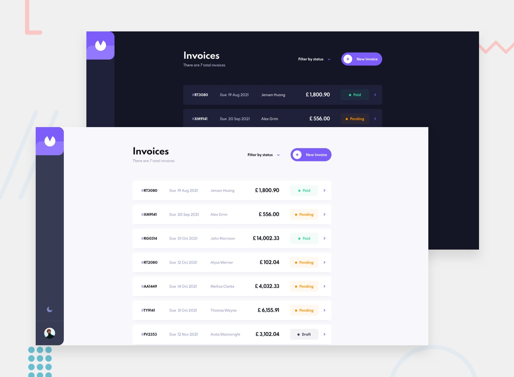

# Invoice Manager

A responsive invoicing app: sign in with Google, then create, edit, filter and track your invoices.

Live demo: https://invoice-lovat.vercel.app



## What it does

- Google sign-in (Firebase Authentication)
- Create, edit and delete invoices, with line items and a computed total and payment due date
- Mark invoices as paid; filter the list by Draft, Pending or Paid
- Per-user storage in Firestore (`users/{uid}/invoices`)
- Profile picture upload (Firebase Storage)
- Light and dark mode, desktop and mobile layouts

## Stack

- Next.js 16 (pages router), React 18, TypeScript
- Redux Toolkit + React Redux
- Firebase (Auth, Firestore, Storage)
- react-hook-form + zod for form validation
- MUI 5 with Emotion (avatar, icons, dayjs date adapter)
- CSS Modules

## Run locally

Requires Node 20.9+ and a Firebase project with Google sign-in, Firestore and Storage enabled.

```bash
git clone https://github.com/lucaszebre/invoice.git
cd invoice
npm install
cp .env.example .env.local   # then fill in the values
npm run dev                  # http://localhost:3000
```

Environment variables (from your Firebase web app config), listed in `.env.example`:

- `NEXT_PUBLIC_FIREBASE_API_KEY`
- `NEXT_PUBLIC_FIREBASE_AUTH_DOMAIN`
- `NEXT_PUBLIC_FIREBASE_PROJECT_ID`
- `NEXT_PUBLIC_FIREBASE_STORAGE_BUCKET`
- `NEXT_PUBLIC_FIREBASE_MESSAGING_SENDER_ID`
- `NEXT_PUBLIC_FIREBASE_APP_ID`

They are also needed for `npm run build`: without them the build stops with `auth/invalid-api-key`.

Other scripts: `npm run build`, `npm start`.

## Status

Built in 2023 as a learning project; not actively maintained.
